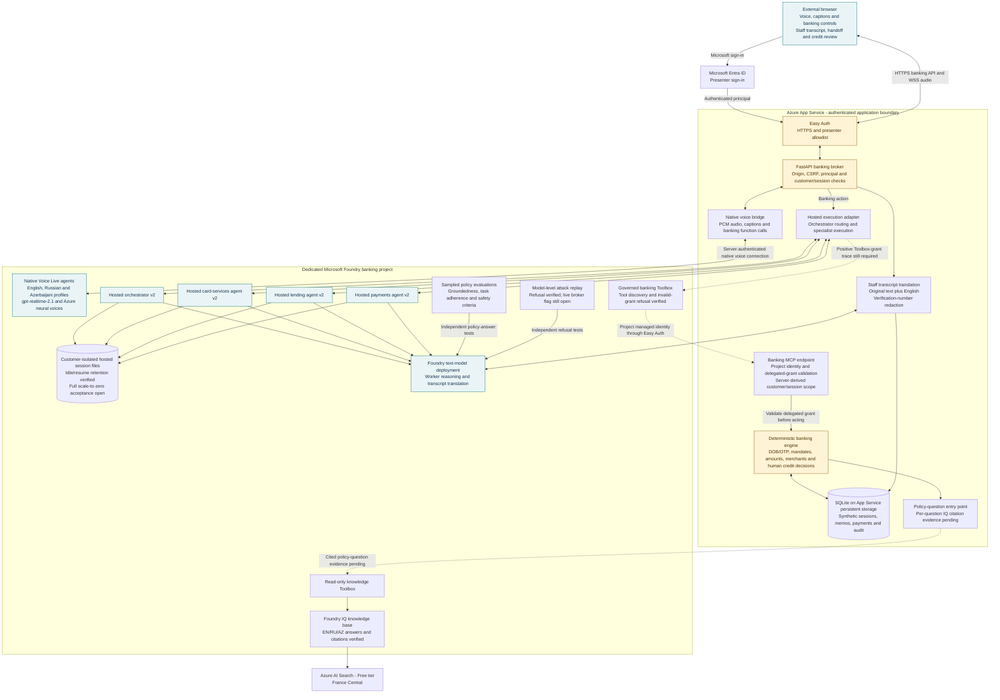
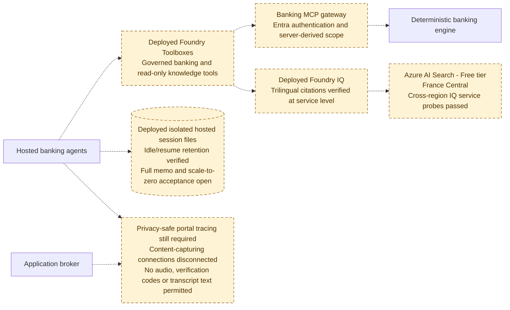

# Banking application architecture

This diagram describes the deployed synthetic Contoso Bank demonstration,
not a production banking system. It separates the current application from
integrations that still need deployed acceptance evidence.

The latest implementation handoff reports four deployed v2 hosted agents with
distinct Entra instance identities, trilingual Foundry IQ answers with citations,
and isolated hosted files retained across an idle/resume probe. Earlier native
voice checks returned transcripts and PCM audio in all three languages.

**Presenter acceptance (2026-11-10):** Signed-in journeys, physical voice and
native-language checks were reported satisfactory in the deployed application.
This closes those manual acceptance categories as presenter-reported evidence.
It does not establish a positive Toolbox-grant trace or measured latency.

## Current deployed application

Solid arrows show component relationships. Dashed paths have deployed
components but still need application-level acceptance. The browser never
connects directly to Foundry or receives a Foundry access token.

**Text equivalent:** The presenter signs in through Microsoft Entra ID in an
external browser. App Service authenticates HTTP and WebSocket requests before
the application checks the principal, origin, CSRF token and banking-session
ownership. The server bridges audio to native Foundry voice agents. Banking
function calls use the hosted execution adapter and the four hosted agents.
The configured banking Toolbox reaches the MCP endpoint through a project
managed identity and Easy Auth; invalid grants are refused and audited. A
positive Toolbox-grant trace is still required, separately from the
presenter-accepted banking journeys. The
Python banking engine alone authorizes and applies account changes. Application
records, memos, transcripts and audit remain in SQLite; v2 workers additionally
retain isolated hosted session files. A separate Foundry model translates
redacted staff transcripts. Foundry IQ and its read-only knowledge Toolbox have
returned cited answers in all three languages. Sampled policy and attack-refusal
evaluations run independently of complete live banking journeys.

### How a banking action runs

1. The caller chooses a language and synthetic journey, then starts a microphone
   or text-only connection. The native agent provides audio and captions.
2. A native `banking_action` function call returns to the server-owned voice
   bridge. Manual controls enter the same governed application workflow.
3. The application binds the request to the authenticated presenter and current
   customer/session. Hosted execution uses orchestrator routing and the relevant
   specialist. The banking Toolbox's MCP endpoint validates a delegated grant
   before an operation can proceed. A positive delegated-grant trace remains an
   outstanding technical evidence gate, separately from presenter acceptance.
4. The banking engine checks verification, money and mandate rules in code,
   persists the result, and records the audit. Model-generated text cannot
   authorize a payment or make a credit decision.
5. The result returns to the native agent for speech and to the banking/staff
   interface for display. A requested handoff or credit review is an explicit
   human task, not a claim that another employee has joined the call.

### Identity and storage boundaries

| Boundary | Current behavior |
|---|---|
| Browser to application | Single-tenant Entra authentication, presenter allowlist, HTTPS, same-origin checks, CSRF protection and presenter-bound session ownership. |
| Application to Foundry | App Service managed identity; no Foundry token or key is sent to the browser. |
| Hosted execution | Four distinct Foundry-managed Entra instance identities. The integration handoff reports deployed v2 pins, with v1 retained for rollback. |
| Web sign-in credential | Easy Auth still references a server-side Entra app credential. Official managed-identity/federation deployment code is tested locally, but dedicated identity creation fails with Azure `TenantNotFound` through both CLI and ARM. Active authentication has not been switched; strict secretless compliance remains blocked. |
| Banking state | SQLite retains application state. Hosted v2 additionally uses server-derived customer-isolated session files; entries survived 450 seconds of inactivity. Zero replicas were not observed: scale-down was inferred from the configured idle timeout and slower first response. Explicit scale-to-zero state evidence and the full hosted lending-memo workflow remain acceptance gaps. |
| Knowledge | A separate read-only Toolbox and Foundry IQ returned cited EN/RU/AZ answers from Free-tier Search. This does not prove a complete signed-in browser journey. |
| Telemetry | Automatic Foundry voice monitoring captured synthetic transcript content despite metadata-only approval. The App Insights connections were removed at both account and project scopes, with absent readbacks. No new content rows were observed after disconnection. Azure accepted three user-approved scoped purges covering 252 content-bearing records; all three remained pending at 19:44:01Z on 2026-11-10, and those rows were still queryable. Content-free operational records are excluded. Privacy-safe portal tracing is not accepted. |
| Staff review | One authenticated presenter demonstrates the staff roles. This is not independently staffed production separation of duties. |

## Integration acceptance - not yet complete in the live application

Dashed arrows below represent paths without complete deployed journey acceptance,
not necessarily missing resources. Resource creation and successful service
probes alone do not establish that the corresponding banking workflow works.

**Text equivalent:** Deployed banking and knowledge Toolboxes have different
authorities. The banking gateway must preserve deterministic authorization and
server-derived customer scope; a positive gateway-grant trace remains open.
The read-only knowledge path has demonstrated trilingual IQ citations.
Hosted session-file isolation and retention have service evidence, but complete
memo persistence and explicit scale-to-zero acceptance remain open. Monitoring
must correlate execution without audio, verification codes or transcript
payloads. The content-capturing connections have been disconnected; that
containment is not a replacement for accepted privacy-safe observability.

## Scope decisions and remaining evidence

The current banking application and Foundry project are in Sweden Central.
France Central Free-tier Search was approved as a cross-region extension, and
the integration handoff reports successful trilingual IQ service probes. This
is an exception to the original
single-region wording; a resource's region alone does not guarantee that all
model processing stays in that region.

Language selection is explicit. Changing language ends the current native call
but preserves the banking session and verification; seamless mid-call switching
is not implemented. The survey UI was removed at the user's request. The
separate original procurement sandbox is not part of this banking architecture.

Signed-in journeys, physical voice and native-language checks now have
presenter-reported acceptance. Measured venue-network latency, acknowledgement
timing, separately recorded barge-in evidence, fallback recordings and event
rehearsal remain gates. Sampled model evaluations and local browser tests are
not substitutes for those measurements. Model-level attack refusals were recorded,
but the corresponding live broker flag was not established: no cross-customer
tool call reached that guard in those evaluations. No real banking rails, real customer data,
production telephony or regulatory validation are included.

## Implementation references

| Component | Source |
|---|---|
| Banking and staff browser interface | [`banking.html`](../web/banking.html), [`banking.js`](../web/banking.js) |
| PCM capture and native audio playback | [`voice.js`](../web/voice.js), [`pcm-worklet.js`](../web/pcm-worklet.js) |
| Authenticated application and API | [`cloud_app.py`](../cloud_app.py) |
| Native voice bridge | [`voice_bridge.py`](../voice_bridge.py) |
| Hosted routing and execution adapter | [`hosted_banking.py`](../hosted_banking.py) |
| Hosted worker source | [`cloud/hosted/main.py`](../cloud/hosted/main.py) |
| Banking policy, persistence and audit | [`banking.py`](../banking.py) |
| Staff translation | [`transcripts.py`](../transcripts.py) |
| Sampled cloud evaluations | [`evaluate_foundry.py`](../evaluate_foundry.py) |

The Mermaid blocks are the editable diagram source. GitHub renders them inline;
the text equivalents and tables provide the same architectural information
without relying on color or a graphical renderer.
